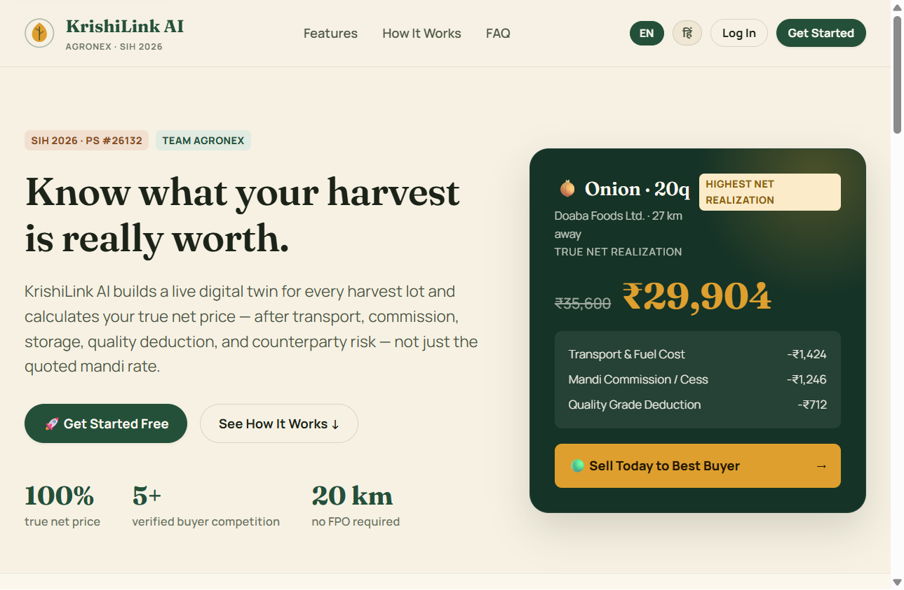
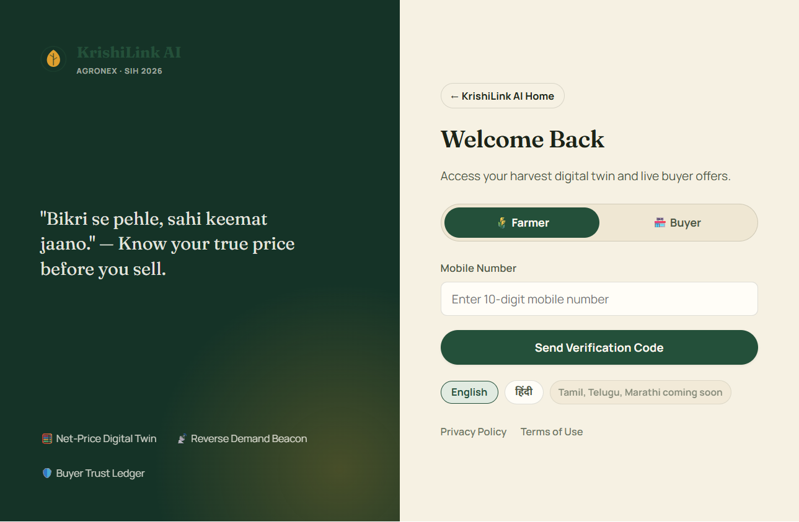
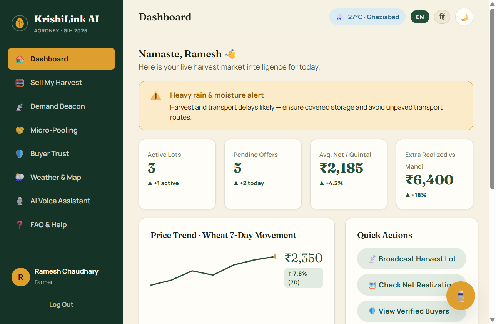
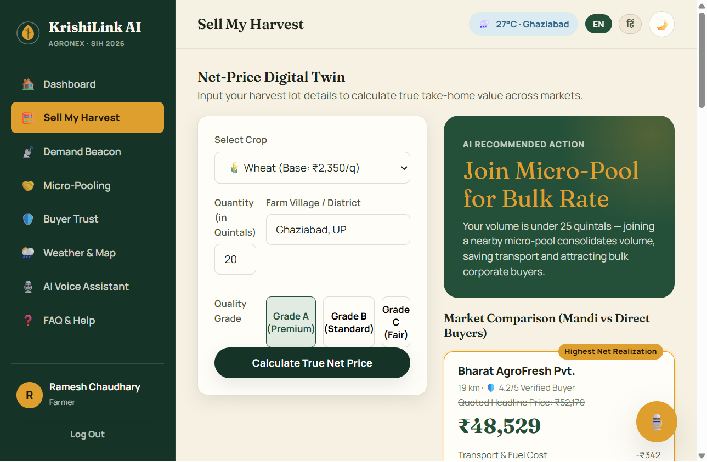
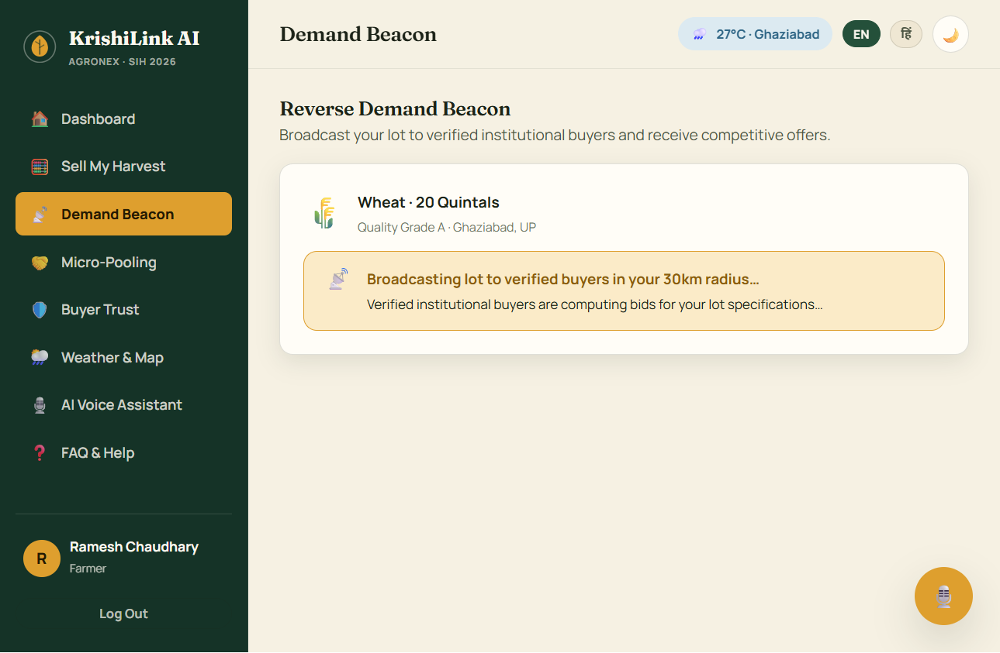
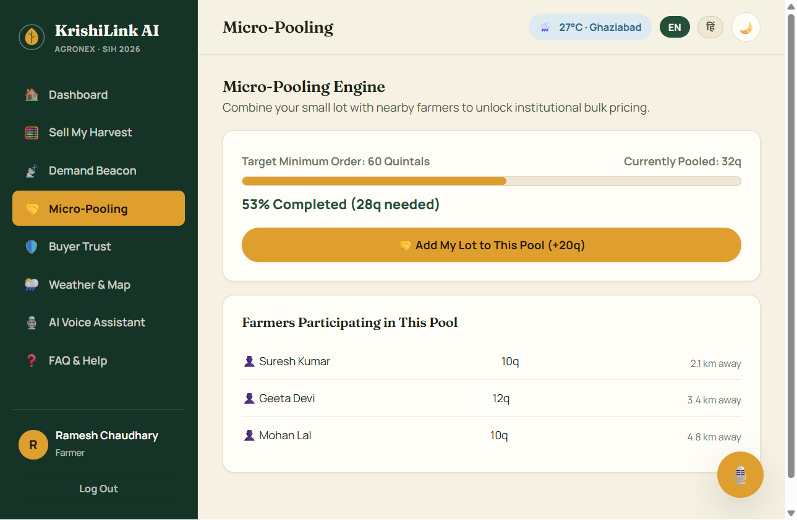
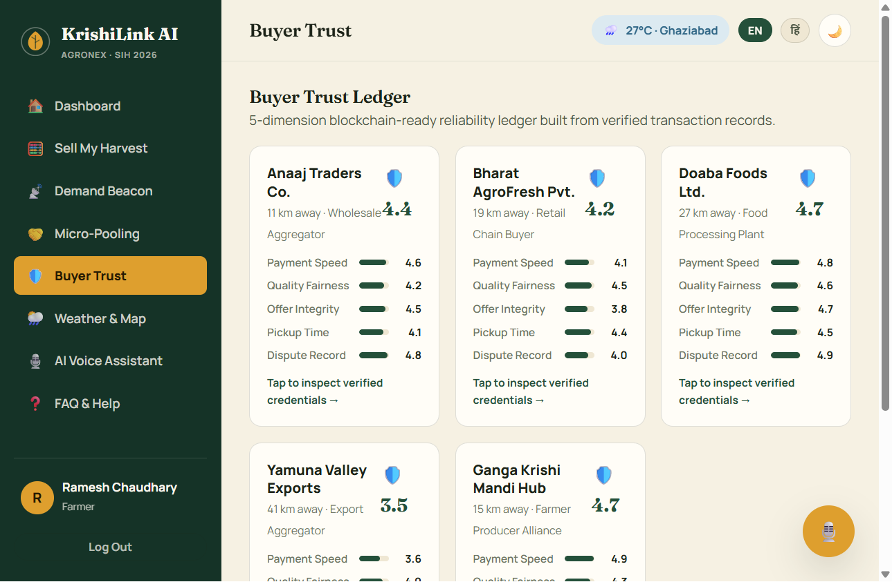
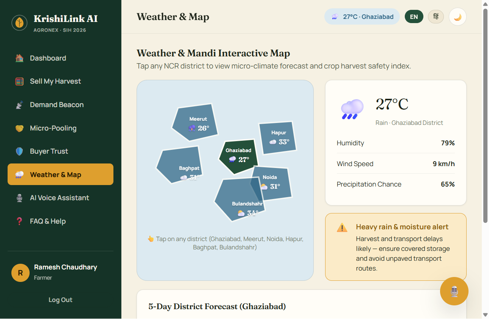
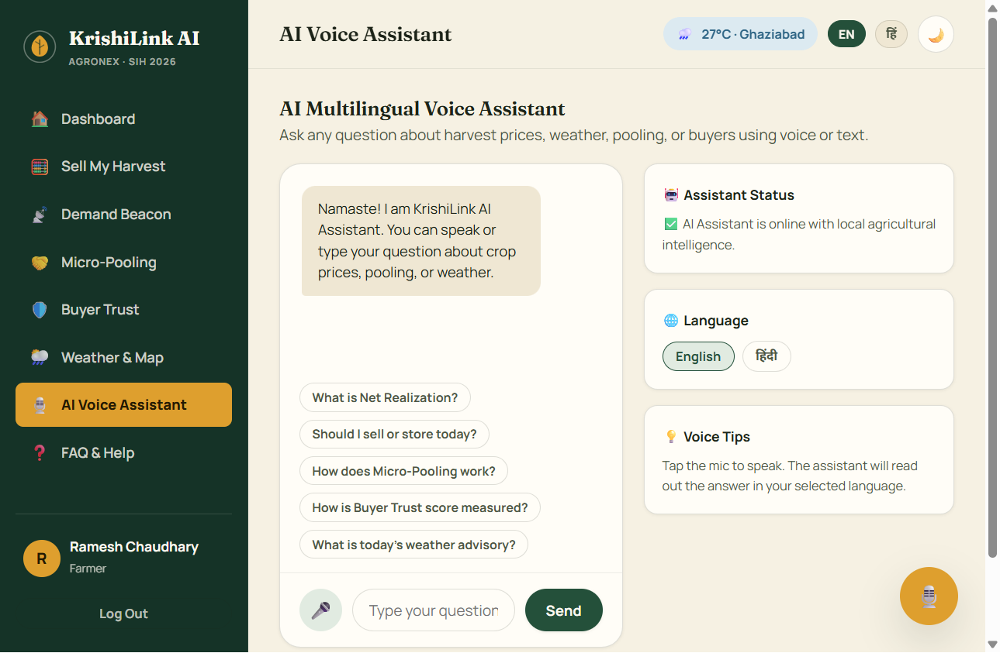
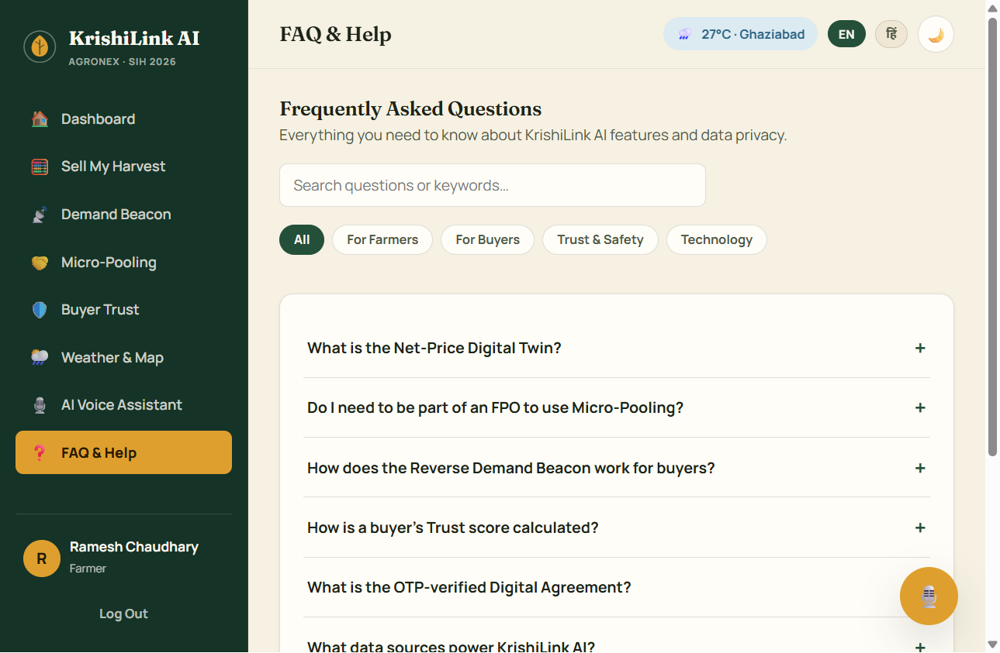

# KrishiLink AI

**Know what your harvest is really worth.** KrishiLink AI is a responsive web prototype for helping smallholder farmers compare the estimated take-home value of a crop lot, find buyers, pool small quantities, and make more informed selling decisions.

The project was created by **Team AgroNEX** for Smart India Hackathon 2026, Problem Statement **#26132: Strengthening Market Linkages & Price Discovery for Farmers**.

> **Prototype notice:** This repository is a front-end demonstration. Prices, weather, buyer records, offers, and dashboard activity are sample or simulated data. Login uses a demo OTP; there is no production authentication, backend, live market feed, or real buyer transaction.

## Run locally

The app is plain HTML, CSS, and JavaScript. No build step, package installation, or npm dependency is required. Serve the project folder over localhost for the most reliable experience, including browser storage and voice features.

### Windows

1. Install Python 3 if it is not already available.
2. Open PowerShell in the project folder.
3. Start the local web server:

   ```powershell
   py -3 -m http.server 8000 --bind 127.0.0.1
   ```

   If the `py` launcher is unavailable, use:

   ```powershell
   python -m http.server 8000 --bind 127.0.0.1
   ```

4. Open [http://127.0.0.1:8000](http://127.0.0.1:8000) in a modern browser.
5. Press **Ctrl+C** in PowerShell to stop the server.

### macOS or Linux

From the project directory, run:

```bash
python3 -m http.server 8000 --bind 127.0.0.1
```

Then open [http://127.0.0.1:8000](http://127.0.0.1:8000). If port 8000 is occupied, choose another port (for example `8001`) and open that port in the browser.

Opening `index.html` directly may work for a basic preview, but localhost is recommended. Speech recognition support depends on the browser and its permissions. Google Fonts are optional; system font fallbacks are provided.

## Demo walkthrough

1. Select **Get Started** or **Log In** on the landing page.
2. Choose a farmer or buyer role and enter any 10-digit phone number.
3. Enter the demo OTP **1234** to open the app.
4. Use the sidebar (or mobile bottom navigation) to explore the pages.
5. On **Sell My Harvest**, choose a crop and quantity, then calculate the estimated net realization.
6. On **Demand Beacon**, broadcast the sample lot and wait for simulated buyer bids.
7. Accepting a sample offer opens the OTP confirmation flow; use **1234** again to view the sample digital agreement.

The app saves selected preferences and demo state in the browser's local storage. Use **Log Out** to return to the public landing page.

## Website pages and features

### Public landing page

Introduces the farmer-price problem and the KrishiLink approach. It includes a sample harvest-price illustration, feature and “how it works” sections, FAQs, language controls, and links to sign-in and legal information.

### Sign-in

Provides farmer and buyer role selection, a 10-digit phone-number field, and a four-digit OTP flow. This is a local demo flow only; it does not send an SMS or validate a real account. The demonstration code is `1234`.

### Farmer dashboard

Presents a sample market overview: active lots, pending offers, average net price, a wheat trend, recent activity, quick links, and a weather snapshot. The displayed metrics are illustrative.

### Sell My Harvest — Net-Price Digital Twin

Accepts a crop, quantity, village or district, and quality grade. The calculator compares estimated mandi and direct-buyer outcomes, showing deductions such as transport and mandi commission alongside the resulting net realization and a suggested next step. The calculation is based on the sample data bundled with the app, not a live quote.

### Demand Beacon

Lets a farmer broadcast a sample harvest lot to nearby buyers. The demo then presents competitive offers with buyer information and countdowns. A farmer can accept an offer and step through the demo OTP and agreement flow.

### Micro-Pooling

Shows nearby sample farmer lots contributing toward a shared minimum order. Farmers can add their own lot to the pool and see the pooled-volume progress update. It demonstrates how small quantities could be combined without requiring an FPO membership.

### Buyer Trust

Displays sample buyer cards and five reliability dimensions: payment speed, quality fairness, offer integrity, pickup punctuality, and dispute history. Selecting a buyer opens the available sample credentials and trade information.

### Weather & Map

Shows an interactive district map for Ghaziabad, Meerut, Noida, Hapur, Baghpat, and Bulandshahr, with a district forecast, humidity, wind, precipitation chance, and a harvest advisory. Forecasts are generated for demonstration and are not an operational weather service.

### AI Voice Assistant

Offers suggested agricultural questions and a chat-style interface for sample guidance about pricing, pooling, weather, and buyer trust. Where supported by the browser, the microphone uses the Web Speech API and answers can be read aloud. Voice features require microphone permission and may not be available in every browser.

### FAQ & Help

Provides searchable questions, grouped into farmer, buyer, trust, and technology topics. Answers explain how the prototype's features are intended to work.

### Profile and legal information

The profile is available from the signed-in user area. Privacy and terms pages are linked from the public and sign-in screens. These are informational prototype pages, not substitutes for production legal or account services.

## Screenshots

The following captures show the public pages and the signed-in farmer experience. Some screenshots show demo interactions (such as a completed price calculation or a broadcast in progress).

<details>
<summary>Public landing page</summary>
<p></p>
</details>

<details>
<summary>Sign-in page</summary>
<p></p>
</details>

<details>
<summary>Farmer dashboard</summary>
<p></p>
</details>

<details>
<summary>Sell My Harvest — calculated net-price estimate</summary>
<p></p>
</details>

<details>
<summary>Demand Beacon — sample lot broadcast</summary>
<p></p>
</details>

<details>
<summary>Micro-Pooling</summary>
<p></p>
</details>

<details>
<summary>Buyer Trust</summary>
<p></p>
</details>

<details>
<summary>Weather & Map</summary>
<p></p>
</details>

<details>
<summary>AI Voice Assistant</summary>
<p></p>
</details>

<details>
<summary>FAQ & Help</summary>
<p></p>
</details>

## Languages, layout, and browser support

- English and Hindi interface options are available from the language controls.
- The interface adapts to desktop and mobile layouts and includes light and dark themes.
- Voice input and speech output depend on the browser's Web Speech API implementation and user permissions.
- Core UI behavior and sample calculations are implemented in browser-side JavaScript.

## Project structure

```text
krishilink-ai/
├── index.html                 # App entry point and metadata
├── css/
│   └── style.css              # Responsive layout, components, and themes
├── js/
│   ├── data.js                # Demo crops, markets, buyers, regions, and translations
│   └── app.js                 # Rendering, interactions, calculations, and demo flows
├── assets/
│   ├── favicon.svg
│   ├── logo.svg
│   └── screenshots/           # README page captures
├── LICENSE
└── README.md
```

## Deployment

Because this is a static site, it can be hosted from the repository root using GitHub Pages or another static web host. For GitHub Pages, push the project to a repository, then select **Settings → Pages → Deploy from a branch**, choose the `main` branch and `/ (root)` folder, and save.

## Project

- **Team:** AgroNEX
- **Event:** Smart India Hackathon 2026
- **Problem statement:** #26132 — Strengthening Market Linkages & Price Discovery for Farmers
- **Organization:** Ministry of Agriculture & Farmers Welfare

## License

Distributed under the MIT License. See [LICENSE](LICENSE) for details.
